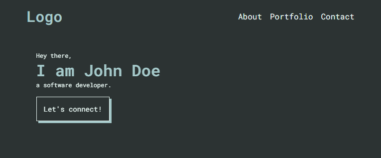

# Outlines Portfolio Template

A responsive and minimalistic portfolio template that anyone can use 💞.



## Features

✅ Fast

✅ FREE

✅ Mobile Responsive

✅ SEO Friendly

✅ Compatible with any web server

## Analytics

The site uses a first-party tracking client in `script.js`. It sends page views and
link clicks to the endpoint configured in `tracking-config.js`; no third-party
analytics service is required.

Before deploying:

1. Change `endpoint` in `tracking-config.js` to your own API endpoint.
2. Set `enabled` to `false` if tracking should be disabled.
3. Implement a `POST` endpoint that accepts JSON in this shape:

   ```json
   {
     "name": "outbound_link_click",
     "properties": {
       "url": "https://example.com/",
       "text": "Live demo"
     },
     "path": "/",
     "referrer": null,
     "timestamp": "2026-11-12T21:33:14.523Z"
   }
   ```

The client sends no cookies, visitor IDs, or personal profiles. Your server and
hosting provider may still log IP addresses or other request metadata, so configure
retention and privacy controls on the backend.

### Run the frontend and backend

The frontend is a Vite application. Install its dependencies and build it
before serving it through the backend:

```powershell
cd frontend
npm install
npm run build
```

For development, run `npm run dev` in `frontend`. Its API and uploaded asset
requests are proxied to the backend at `http://localhost:30073`.

The `backend` folder contains a Node.js server with a login-protected dashboard.
It stores events locally in `backend/data/events.jsonl`.

1. Copy `backend/.env.example` to `backend/.env` and set a strong password.
2. Keep the credentials in `backend/.env`; the backend loads this file at
   startup. You can also set environment variables in your hosting platform.
3. Build the frontend, then start the server from the backend folder:

   ```text
   node server.js
   ```

4. Open `http://localhost:30073` for the portfolio and
   `http://localhost:30073/admin` for the tracking login and contact messages.

The Vite development server runs on `http://localhost:30074`; use that URL
while developing. In the production Docker deployment, the backend serves the
built frontend on port `30073`, so there is no separate production frontend
port.

For Windows PowerShell, set the credentials before starting if you are not
using `backend/.env`:

```powershell
$env:ADMIN_USERNAME = "admin"
$env:ADMIN_PASSWORD = "use-a-long-random-password"
node .\server.js
```

The included server keeps sessions in memory, so all users are logged out when
the server restarts. Deploy it behind HTTPS and do not commit real passwords or
the generated `backend/data/events.jsonl` or `backend/data/contacts.jsonl` files.

## How to use

1. Close or manually download the code.
2. Open the `index.html` file in your browser.
3. If everything looks good, upload it to your server.

## I am not a web developer, how do I setup my portfolio website?

> Need help with setting up your portfolio website?

Contact us at https://ossph.org
